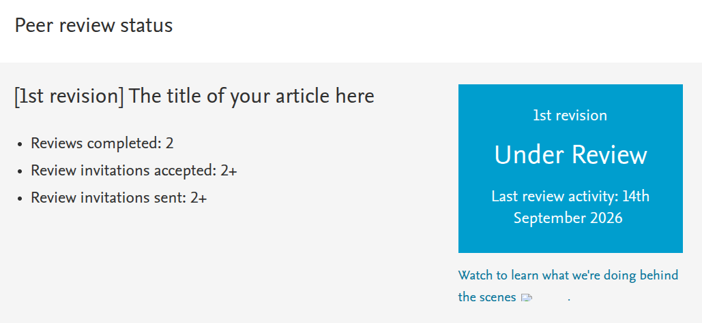
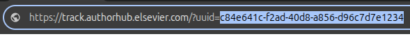

# Monitor do Elsevier Author Hub

Script em Python que monitora a página de acompanhamento de revisão por pares da Elsevier (**Author Hub Tracker**) e envia uma notificação push para o celular sempre que algo muda: status, número de revisões concluídas, convites aceitos, data da última atividade etc.



## Como funciona

A página `track.authorhub.elsevier.com` é renderizada via JavaScript e busca os dados de uma [API que retorna JSON](https://github.com/KarlRaphel/elsevier-tracker-web). Em vez de raspar o HTML, o script consulta essa API diretamente.

A cada execução, o script:

1. Busca o JSON atual do manuscrito.
2. Compara com a última versão salva em `elsevier_estado.json`.
3. Se houver diferença, lista exatamente o que mudou e envia uma notificação via [ntfy.sh](https://ntfy.sh).

## Pré-requisitos

- Python 3.8+
- Biblioteca `requests`
- App **ntfy** no celular ([Android](https://play.google.com/store/apps/details?id=io.heckel.ntfy) / [iOS](https://apps.apple.com/app/ntfy/id1625396347)), opcional

```bash
pip install -r requirements.txt
```

## Configuração

### 1. Encontre o UUID do seu manuscrito

O UUID está no final do link de acompanhamento que a Elsevier envia por e-mail, logo depois de `?uuid=`:



Copie esse valor para a variável `UUID` em `monitor_elsevier.py`:

```python
UUID = "c84e641c-f2ad-40d8-a856-d96c7d7e1234"
```

### 2. Configure as notificações

Escolha um nome de tópico único e difícil de adivinhar, porque qualquer pessoa que souber o nome poderá ler as mensagens. Coloque esse nome na variável `NTFY_TOPIC`:

```python
NTFY_TOPIC = "meu-artigo-elsevier-2026"
```

Em seguida, abra o app ntfy no celular e assine o mesmo tópico. Se preferir não receber notificações, deixe `NTFY_TOPIC = ""`; as mudanças continuarão aparecendo no terminal.

### 3. Ajuste o intervalo (opcional)

```python
INTERVALO = 60 * 60   # 60 minutos
```

Checar a cada 60 minutos é suficiente. O status de revisão muda devagar, e não é preciso sobrecarregar o serviço.

## Uso

### Execução única

```bash
python monitor_elsevier.py
```

Checa uma vez e termina. Na primeira execução, o script apenas salva o estado atual como referência. Esse modo é ideal para usar com agendadores.

### Modo contínuo

```bash
python monitor_elsevier.py --loop
```

Fica rodando indefinidamente e checa a cada `INTERVALO` segundos. O terminal precisa ficar aberto, e o monitoramento para se o computador desligar ou entrar em suspensão. Para encerrar, use `Ctrl+C`.

No Linux ou Mac, para rodar em segundo plano:

```bash
nohup python monitor_elsevier.py --loop > log.txt 2>&1 &
```

### Agendamento (recomendado)

O agendamento é mais robusto que o `--loop`, porque volta a funcionar sozinho depois de um reinício.

**Linux/Mac (cron):** execute `crontab -e` e adicione:

```
*/30 * * * * /usr/bin/python3 /caminho/para/monitor_elsevier.py >> /caminho/para/log.txt 2>&1
```

**Windows:** abra o Agendador de Tarefas, crie uma tarefa básica e configure:

- **Programa:** `python`
- **Argumentos:** `C:\caminho\para\monitor_elsevier.py`
- **Repetição:** a cada 30 minutos

## Exemplo de saída

```
[2026-09-27 10:00:00] Primeira execução: estado salvo. Status atual: Under Review
[2026-09-27 10:30:00] Sem mudanças.
[2026-09-28 14:30:00] Seu artigo na Elsevier mudou!
~ ReviewSummary.ReviewsCompleted: 2 -> 3
~ LastUpdated: 1789344000 -> 1790604000
```

## Solução de problemas

| Problema | Causa provável | Solução |
|---|---|---|
| Erro `403` ou `404` | A URL da API mudou | Confirme a URL (veja abaixo) e atualize `API_URL` |
| Nenhuma notificação chega | Tópico diferente no app e no script | Verifique se `NTFY_TOPIC` é idêntico ao tópico assinado |
| Notificação logo na 2ª execução | Mudança real ou campo volátil na API | Verifique a mensagem; se um campo muda sempre, ignore-o na comparação |

### Como confirmar a URL da API

1. Abra a página do tracker no navegador.
2. Pressione **F12** e vá para a aba **Network** (Rede).
3. Filtre por **Fetch/XHR** e recarregue a página.
4. Encontre a requisição que retorna o JSON com o status do manuscrito.
5. Copie a URL dessa requisição para a variável `API_URL`.

## Estrutura do projeto

```
elsevier-tracker/
├── README.md
├── monitor_elsevier.py     # script principal
├── requirements.txt
├── .gitignore
├── elsevier_estado.json    # gerado automaticamente (último estado)
└── img/
    ├── peer-review-status.png
    └── url-uuid.png
```

## Aviso

Este projeto não é oficial e não tem nenhuma afiliação com a Elsevier. Ele usa um endpoint não documentado, que pode mudar a qualquer momento. Use com moderação.
